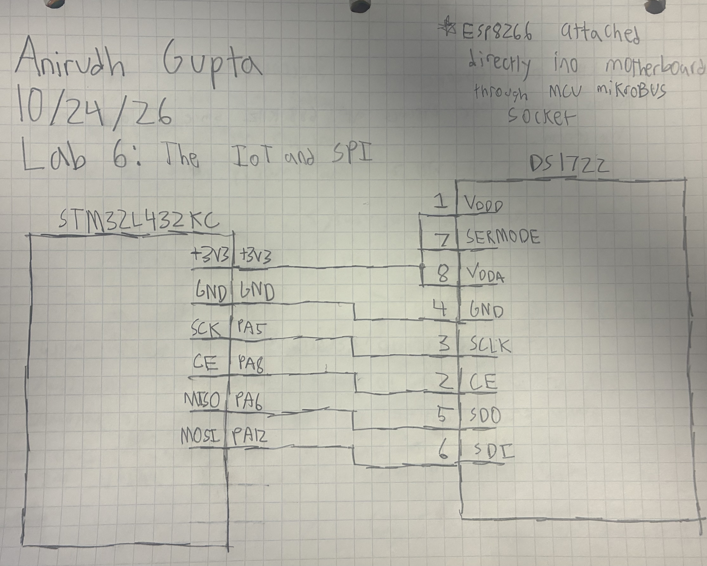
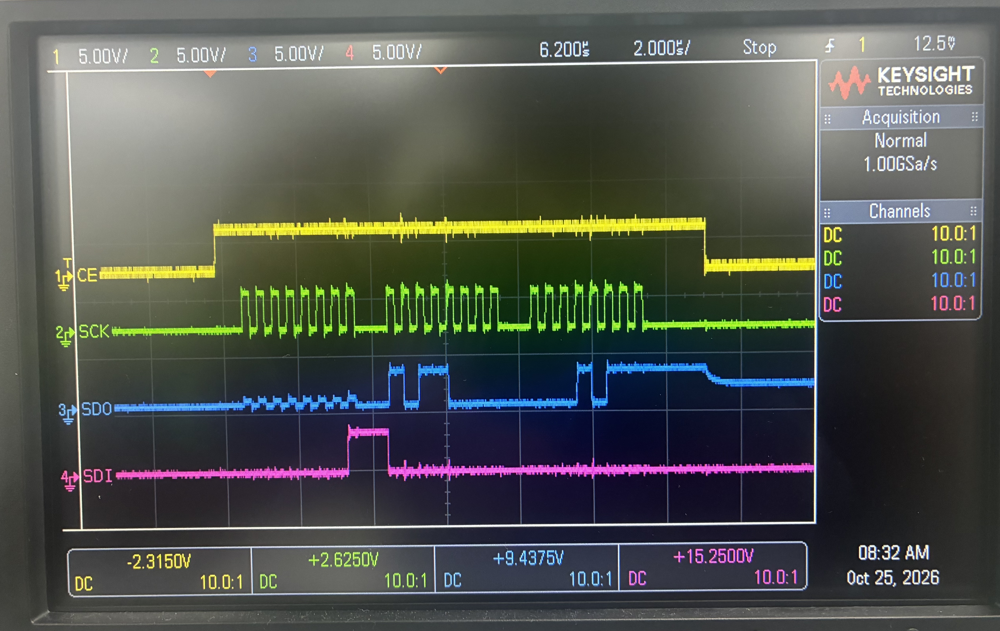

# Introduction

In this lab I used C to program an STM32 MCU to build an IoT device. I implemented SPI functionality on the MCU to communicate with a temperature sensor. I interacted with a WiFi modile over UART to write an HTML page.

# Design and Testing Methodology

In this lab I used the STM32 MCU, ESP8266 WiFi module, and a DS1722 Digital Thermometer. The STM32 MCU was responsible for reading the temperature sensor via SPI and sending the data to the ESP8266 module over UART. The ESP8266 module then served an HTML page displaying the temperature data. The HTML page was also used to control an on board LED.

In order to complete this lab, I first programmed the SPI functionality in C. I then tested the SPI functions by connecting an oscilliscope to the MCU pins to verify that I was getting the correct waveforms. After confirming the SPI communication, I wired the temperature sensor to the MCU and verified that I had a full correct SPI read transaction (CE, SCK, SDO, SDI). Once I verified the temperature sensor and the MCU were able to communicate, I integrated the temperature data with the ESP8266 module over UART and tested the HTML page to ensure it correctly displayed the temperature data and controlled the on board LED. I did this lab part by part to make the debugging process easier.

I also used CMSIS device templates for my source code files. The ESP8266 module connected easily into the motherboard, and the DS1722 consisted of simple wiring to the MCU.

# Technical Documentation

GitHub Repository: [e155-lab6 GitHub Repository](https://github.com/TheRealAniG/e155-lab6)

## Schematic

The schematic in Figure 1 shows the full circuit design for the lab. The DS1722 temperature sensor is connected to the STM32 MCU via SPI. The ESP8266 WiFi module is connected to the MCU directly on the motherboard.

## Waveform

Figure 2 shows an oscilloscope output capturing a full SPI read transaction with the DS1722 temperature sensor (CE,SCK,SDO,SDI).

# Results and Documentation

The design performed exactly as expected. It was able to accurately communicate with the DS1722 temperature sensor via SPI and successfully transmit the data to the ESP8266 WiFi module over UART. The HTML page correctly displayed the temperature data and controlled the on board LED.

# Conclusion

Lab 6 was successful, everything worked as intended. I was able to successfully program the MCU using C code and communicate with the DS1722 temperature sensor via SPI, transmitting the data to the ESP8266 WiFi module over UART. I spent around 20 hours on this lab.

# AI Prototype Summary

I gave two prompts to ChatGPT Plus:

1.I’m making a web portal to interface with a temperature sensor. Create a HTML page that looks good and is intuitive to show the temperature, control an LED, and change the precision of the readout.

2.Write me a C function to carry out a SPI transaction to retrieve a temperature reading from a DS1722 sensor. Make use of CMSIS libraries for the STM32L432KC.

For the first prompt it created a web page which looked significantly nicer than the one I made. The outputs were all intuitive and made sense and it was aethetically pleasing. I think AI is very good at making websites/apps.

For the second prompt it created resonable and clean code. The code looked good, but I wasn't able to inegrate it with the rest of my code easily since it was written with a slightly different design in mind. 